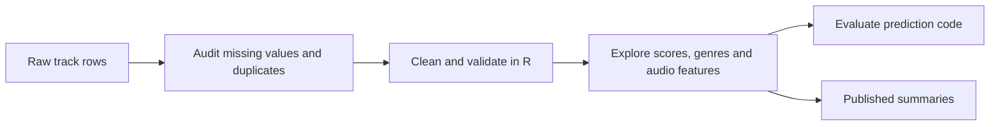
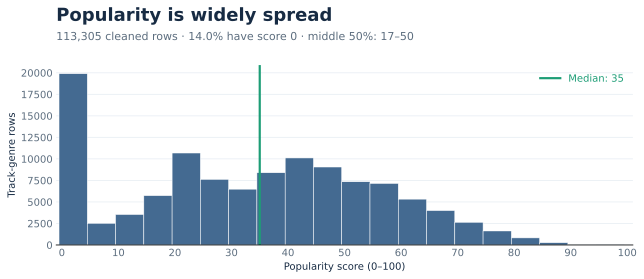
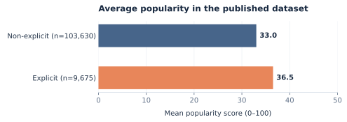
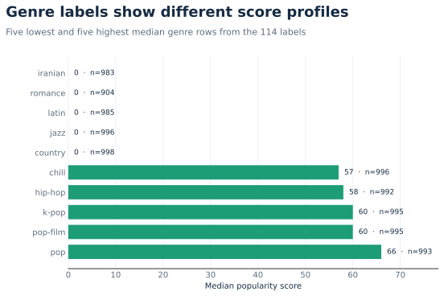
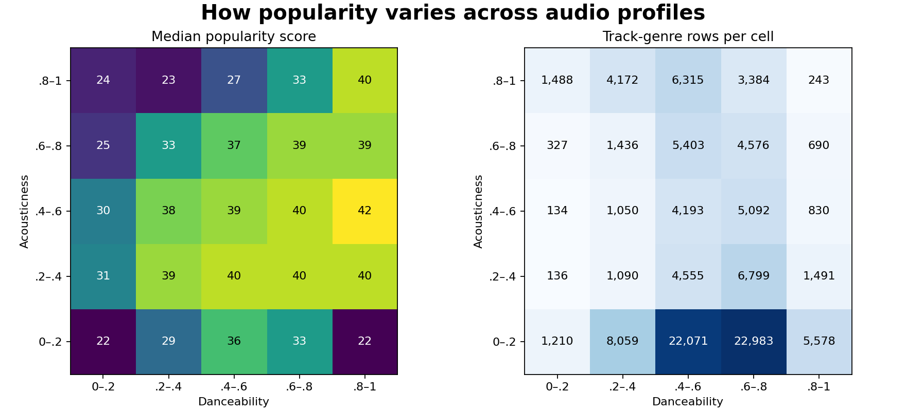

# Spotify song popularity analysis in R

This team project asks which track and audio characteristics are associated with a Spotify track's **popularity score**, and whether those characteristics can help estimate that score. The work moves from data auditing and preparation to visual exploration and prediction code. The figures below show what the **published data** supports; they do not turn descriptive patterns into claims about causes or model performance.

## The data behind the analysis

| Stage | Track-genre rows | What is available here |
| --- | ---: | --- |
| [Raw input](data/raw/spotify_tracks_data.csv) | **114,000** | Track identity, genre, popularity, and audio features. |
| [Cleaned input](data/processed/spotify_tracks_clean.csv) | **113,305** | The published dataset used for the README charts and much of the analysis. |

The cleaned file has **89,553 unique track IDs** across **114 genre labels**. A track can appear under more than one genre, so a row is not always an independent song. In the published files, the raw CSV has 3,553 missing cells; the cleaned CSV has none and has no exact duplicate rows. The [preparation script](scripts/02_data_preparation.R) explains the cleaning and validation decisions, including why repeated track IDs are examined separately from redundant rows.



## What the published results show

### 1. Popularity is spread widely



The cleaned rows have a **median popularity of 35** and a middle half from **17 to 50**. About **14.0%** of rows have a score of zero. That wide distribution matters when comparing groups: an average alone can hide both the zero-heavy part and the higher-scoring tail. This chart counts *track-genre rows*, not unique songs. It is generated from the [published cleaned CSV](data/processed/spotify_tracks_clean.csv).

### 2. Explicit and non-explicit rows differ in their averages



The [published summary table](outputs/tables/popularity_by_explicit.csv) reports mean popularity **33.0** for 103,630 non-explicit rows and **36.5** for 9,675 explicit rows. This is a descriptive group difference. The groups may also differ in genre, audience, or other characteristics, so the chart does not show an effect caused by the explicit flag.

### 3. Single audio features have weak linear correlations


Among the variables in the [published correlation table](outputs/tables/popularity_correlations.csv), instrumentalness has the largest absolute correlation with popularity, about **−0.094**. Loudness is about **+0.047**. Even the largest value is small, which supports looking beyond one feature at a time. Correlation measures only a linear association here; it is not a prediction score.

### 4. Genre rows can have very different score profiles



The chart shows five labels from each end of the **114 genre medians**. The selected labels each have roughly 900–1,000 cleaned rows; for example, the median is **0** for several low-end labels and **66** for `pop` rows. This is a comparison *within this dataset*, not a universal ranking of musical genres. Genre labels overlap for some tracks, and the input gives each label roughly similar row counts. The [chart script](figures/build_readme_charts.py) makes the selection and calculation reproducible.

### 5. Does the relationship with danceability depend on acousticness?

The two panels use the same 25 groups. Find a square on the left to read the median popularity score, then look at the same position on the right to see how many rows support it. Each axis uses the five equal-width feature ranges defined in the team's R analysis. Boundary values enter the higher band, and the last band includes 1.0.



Among rows with acousticness below 0.2, the median rises from 22 in the lowest danceability band to 36 in the middle band, then falls back to 22 in the highest. For acousticness of 0.4 to below 0.6, the corresponding medians are 30.5, 39 and 42 (the plot rounds cell labels). A single correlation compresses those different shapes into one number. The count panel also shows how uneven the evidence is. That middle band's median of 39 uses 4,193 rows, while the median of 42 uses 830. These are comparisons within the cleaned collection, where tracks may contribute multiple rows. [Original R grouping](scripts/06_objective3_categories.R) · [Rebuild this figure with Python](figures/plot_walkthrough.py)

## How prediction is evaluated

The musical-structure analysis groups the split by track ID so that different genre entries for a song stay together. It predicts a score for each held-out row three ways. The baseline always predicts the training mean. The first regression estimates separate effects for key, mode and time signature. The second also allows their effects to vary together. Comparing all three on the same held-out rows tests whether musical structure adds information beyond the average. Mean absolute error expresses a typical miss in popularity points, while root mean squared error gives larger misses more weight. [Evaluation code](scripts/07_objective4_prediction.R)

## How the analysis is organized

| Stage | What to read | Question it addresses |
| --- | --- | --- |
| Import and prepare | [Audit](scripts/01_import_and_audit.R), [preparation](scripts/02_data_preparation.R), and [general exploration](scripts/03_general_exploration.R) | What is in the dataset, what needs cleaning, and what basic patterns appear? |
| Audio characteristics | [Audio analysis](scripts/04_objective1_audio.R) | How do intensity, mood, tempo, and acoustic properties relate to popularity? |
| Duration and categories | [Duration, explicit status, and genre](scripts/05_objective2_rhythm.R) | Do track duration and categorical groups show different popularity profiles? |
| Feature combinations | [Combined audio characteristics](scripts/06_objective3_categories.R) | Do pairs of characteristics separate scores more clearly than single variables? |
| Prediction | [Musical structure and prediction](scripts/07_objective4_prediction.R) | How are key, mode, and time signature examined, and how is prediction evaluated in code? |

The [combined R workflow](Group25.R) collects the published analysis. The repository includes prediction code, but this README does **not** claim a verified model score: the result tables needed to substantiate a public performance summary are not currently committed. The four figures above are descriptive views of committed data and summaries.

## Reproduce and inspect

From the repository root, use R with `dplyr`, `ggplot2`, and `rpart` installed:

```bash
Rscript --vanilla Group25.R
```

The combined script expects `data/raw/spotify_tracks_data.csv` and writes generated outputs locally. [scripts/Main.R](scripts/Main.R) covers audit, preparation, and general exploration rather than the whole combined analysis. The two additional README charts can be rebuilt from the committed cleaned CSV with Python, pandas, and Matplotlib:

```bash
python figures/build_readme_charts.py
```

This Python command only rebuilds the presentation charts; the project analysis remains in R. The explicit-status and correlation charts use the linked published summary tables.

**Limits and credit:** The dataset is a prepared collection of track-genre rows, not a random sample of all Spotify listening. The figures establish neither causality nor predictive accuracy on unseen tracks. This was shared team work; the repository history and code provide the detailed record, and this overview does not assign individual credit by stage.
