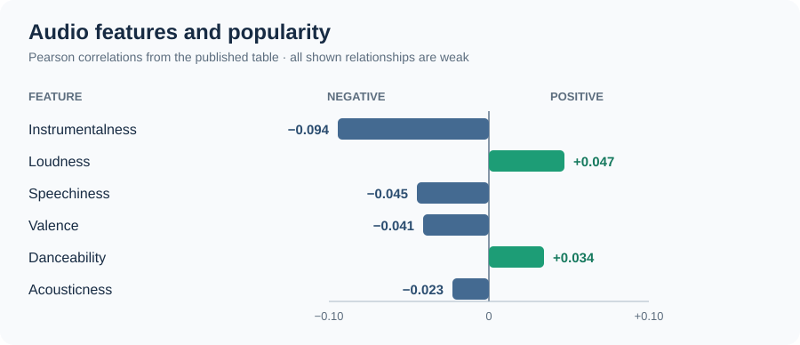
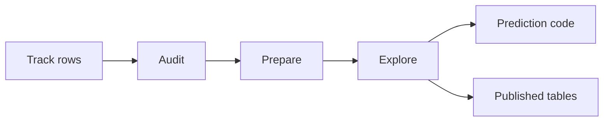

# Spotify song popularity analysis in R

**What does this track dataset reveal about popularity?** Our team audited and prepared Spotify track data, explored audio features and categories, and wrote prediction code in R. This page leads with two descriptive views you can check against the published tables.

| Dataset rows | Unique track IDs | Genres |
| ---: | ---: | ---: |
| **113,305** | **89,553** | **114** |

Some track IDs occur in more than one genre, so rows are not all independent songs.

## Two questions from the data

### Does the explicit flag separate average popularity?


Mean popularity is **33.0** across 103,630 non-explicit rows and **36.5** across 9,675 explicit rows in the [published summary](outputs/tables/popularity_by_explicit.csv). This is a group comparison, not evidence that the explicit flag causes the difference.

### Which numeric features have the strongest linear relationship?



The largest absolute correlation in the [published correlation table](outputs/tables/popularity_correlations.csv) is only about **0.09**. These are weak linear relationships in this dataset; the chart does not measure model accuracy or causality.

## Follow the work



| Start here | What you will find |
| --- | --- |
| [Combined workflow](Group25.R) | The published version's full R analysis in one file. |
| [Audit](scripts/01_import_and_audit.R) and [preparation](scripts/02_data_preparation.R) | Data checks and cleaning steps. |
| [Exploration](scripts/03_general_exploration.R) | Descriptive analyses behind the charts and tables. |
| [Prediction code](scripts/07_objective4_prediction.R) | Implemented modelling stage; this README does not claim a verified prediction score. |
| [Published tables](outputs/tables) and [raw data](data/raw) | Numbers and input files for checking the overview. |

## Run the published workflow

From the repository root, use R with `dplyr`, `ggplot2`, and `rpart` installed:

```bash
Rscript --vanilla Group25.R
```

The script expects `data/raw/spotify_tracks_data.csv` in this repository and writes generated outputs locally. For a quicker review, open the linked scripts and published tables. `scripts/Main.R` covers audit, preparation, and general exploration rather than the entire combined analysis.

**Interpretation and credit:** Both figures describe associations in the published dataset. Neither establishes a cause or a verified prediction score. This was shared team work; the repository history and files carry the detailed record, and this overview does not assign individual credit by stage.
